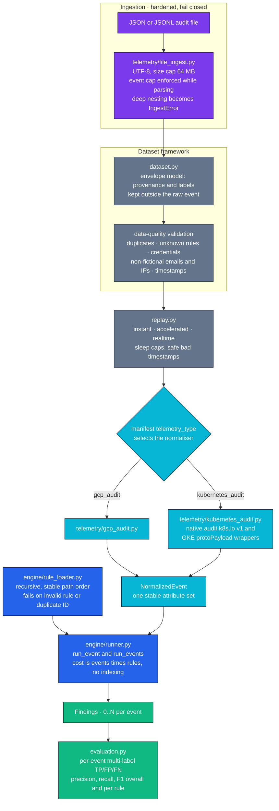
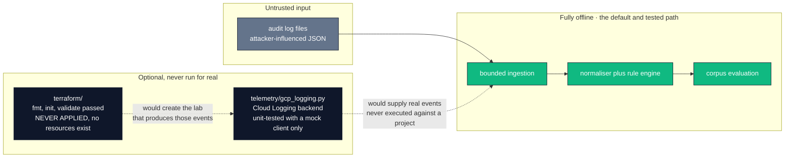

<div align="center">

# ☁️ CloudShield

### Offline detection engineering for GCP IAM and Kubernetes audit logs

**Normalise cloud audit events, evaluate versioned YAML detection rules against them, and score the
result against a labelled corpus — with no GCP project, no credentials and no API calls.
The ingestion path is hardened to fail closed on oversized, deeply nested and malformed input.**

[](https://github.com/ckvishwa/Cloudshield/actions/workflows/ci.yml)
[](https://github.com/ckvishwa/Cloudshield/actions/workflows/ci.yml)
[](pyproject.toml)
[](rules/)
[](datasets/)

[](src/cloudshield/telemetry/gcp_audit.py)
[](src/cloudshield/telemetry/kubernetes_audit.py)
[](terraform/)
[](#-known-limitations)

[Overview](#-overview) · [Problem](#-problem-statement) · [Detections](#-detections) · [Architecture](#-system-architecture) · [How it works](#-how-it-works) · [Hardening](#-ingestion-hardening) · [Results](#-results--validation) · [Testing](#-testing--quality-assurance) · [Quick start](#-quick-start) · [Limits](#-known-limitations)

</div>

---

## 📌 Overview

| | |
|---|---|
| **What it does** | Parses GCP Cloud Audit Log and Kubernetes/GKE audit events, normalises them into one stable attribute set, evaluates 8 detection-as-code YAML rules against each event, and scores the findings against labelled corpora with per-rule precision, recall and F1. |
| **The problem it solves** | Cloud detection rules are usually written against documentation and never executed. Here every rule runs against a labelled corpus on every CI run, so a rule change that breaks a detection fails the build instead of being discovered in production. |
| **Who benefits** | Detection engineers who need a rule to be reviewable and testable like code, and anyone who has to decide what an audit log does **not** prove. |
| **Why the architecture** | One generic rule runner plus per-telemetry normalisers. Adding Kubernetes required a new normaliser only — the runner, loader, dataset framework and evaluator were reused unchanged. That is the whole design claim. |

> Corpus scores are **regression and coverage checks, not production detection accuracy.** The
> corpus was authored alongside the rules. **No live GCP or GKE validation has been performed.**

---

## 🎯 Problem Statement

Audit-log detection has three failure modes this project is built to confront:

1. **Untested rules.** A YAML rule that has never seen an event is a guess. Both corpora run in CI,
   so a regression in rule logic is a build failure.
2. **Over-claiming from a log line.** An audit entry says an API call happened — not that an attack
   succeeded. Each rule here documents what it does *not* show: `K8S-SECRET-001` proves a Secret was
   *accessed*, not stolen; `K8S-WORKLOAD-002` is a configuration finding, not a container escape;
   `GCP-IAM-003` does not say a role was granted, only that a high-risk role was present.
3. **Hostile input in the ingestion path.** Audit logs arrive as attacker-influenced JSON. A file of
   500,000 tiny events, or JSON nested 200,000 deep, must be a handled error — not an
   out-of-memory kill or a `RecursionError`. This was a real defect here, fixed in
   [PR #1](https://github.com/ckvishwa/Cloudshield/pull/1).

---

## ✨ Detections

Eight rules, all plain YAML on the generic engine. Each row states the evidence and the limit of
what it proves.

| Rule ID | Title | Severity | Fires on | Does **not** show |
|---|---|---|---|---|
| [`GCP-IAM-001`](rules/iam/privilege_escalation.yaml) | High-Risk IAM Role Granted | HIGH | A `SetIamPolicy` entry with an `ADD` binding delta for a high-risk role | — *(high-confidence: the role was granted by this call)* |
| [`GCP-IAM-002`](rules/iam/service_account_impersonation.yaml) | Suspicious Service Account Credential Generation | HIGH | Service Account Credentials token generation | That the token was used maliciously |
| [`GCP-IAM-003`](rules/iam/policy_snapshot_high_risk_role.yaml) | High-Risk Role Present in IAM Policy Update | MEDIUM | The policy snapshot contains a high-risk role **and** the entry has no usable binding delta | **That the role was granted** — it may already have been there |
| [`K8S-WORKLOAD-001`](rules/kubernetes/privileged_pod.yaml) | Privileged Pod Created or Updated | HIGH | Pod create/update/patch with `securityContext.privileged: true` in any container, initContainer or ephemeralContainer | `allowPrivilegeEscalation` alone does not count; with no request body the result is **unknown**, not "not privileged" |
| [`K8S-RBAC-001`](rules/kubernetes/rbac_cluster_admin_binding.yaml) | Cluster-Admin ClusterRoleBinding | HIGH | ClusterRoleBinding create/update/patch whose `roleRef` is `ClusterRole`/`cluster-admin` | A namespaced `RoleBinding` is **not covered** |
| [`K8S-WORKLOAD-002`](rules/kubernetes/dangerous_host_workload.yaml) | Dangerous Host-Level Workload Configuration | HIGH | `hostNetwork`, `hostPID`, `hostIPC`, a `hostPath` volume, or an added `SYS_ADMIN`/`SYS_PTRACE` capability | A container escape — it is a **configuration** finding |
| [`K8S-EXEC-001`](rules/kubernetes/pod_exec.yaml) | Pod Exec Activity | MEDIUM | A successful or unknown-outcome `pods/exec` | Malice — exec is routine debugging; a **denied** exec does not alert |
| [`K8S-SECRET-001`](rules/kubernetes/secret_access.yaml) | Kubernetes Secret Access | HIGH | A Secret `get`, `list` or `watch` | That a secret was **stolen or exfiltrated**; only metadata is kept, **never Secret data** |

<details>
<summary><b>Why GCP-IAM-001 and GCP-IAM-003 both exist (and never double-alert)</b></summary>

Both read `SetIamPolicy` audit entries, but they mean different things:

- **GCP-IAM-001 (HIGH)** — an `ADD` binding delta for a high-risk role. High confidence: *this call
  granted the role.*
- **GCP-IAM-003 (MEDIUM)** — the policy snapshot returned by the call (`response.bindings`, else
  `request.policy.bindings`) contains a high-risk role **and** the entry carries no usable binding
  delta. Lower confidence: the role is present, but it may have been there already.

If an entry has a binding delta, only GCP-IAM-001 can fire, so a single change never alerts twice.
Both rules keep an identical high-risk role list, and **a test enforces that they stay identical**.

GCP-IAM-003 exists because the first version of the corpus exposed a real gap in GCP-IAM-001: a
`SetIamPolicy` snapshot containing `roles/owner` with no `bindingDeltas`. The fix was a second,
clearly lower-confidence rule — not a weakening of GCP-IAM-001.

</details>

---

## 🧱 System Architecture



### Trust boundaries and what is offline



Everything in the green box runs in CI on every push. Nothing in the dark box has ever touched a
real GCP project.

---

## 🔄 How It Works

```
audit dataset (JSON/JSONL)
  -> bounded ingestion (file_ingest)
  -> envelope: provenance + expected labels held outside the raw event (dataset.py)
  -> data-quality validation (duplicates, unknown rule IDs, credentials, real-looking emails/IPs)
  -> replay: instant | accelerated | realtime (replay.py)
  -> normalise: gcp_audit | kubernetes_audit, chosen by the manifest's telemetry_type
  -> load_rules(): every *.yaml under rules/, stable order, duplicate IDs rejected
  -> run_event(): one NormalizedEvent against every rule -> 0..N findings
  -> evaluation: per-event multi-label TP / FP / FN -> precision, recall, F1 overall and per rule
```

| Stage | Module | Guarantee |
|---|---|---|
| **Ingest** | `telemetry/file_ingest.py` | UTF-8 (BOM tolerated); 64 MB byte cap; 100,000-event cap enforced **during** parsing; hostile nesting raises `IngestError`; errors carry line numbers |
| **Envelope** | `dataset.py` | Provenance and expected labels are stored *outside* the raw event, so a rule can never read its own answer |
| **Quality gate** | `dataset.py` | Rejects duplicate events, unknown rule IDs, embedded credentials, non-fictional emails and IP addresses, and bad timestamps |
| **Replay** | `replay.py` | Three modes with sleep caps; malformed timestamps handled rather than crashing |
| **Normalise** | `telemetry/gcp_audit.py`, `telemetry/kubernetes_audit.py` | Native `audit.k8s.io/v1` Events and GKE `protoPayload.serviceName: k8s.io` wrappers normalise to the *same* attributes |
| **Load rules** | `engine/rule_loader.py` | Recursive, stable path order; invalid rule or duplicate rule ID is a hard failure |
| **Evaluate** | `engine/runner.py` | `run_event()` returns 0..N findings; cost is O(events × rules), no rule indexing yet |
| **Score** | `evaluation.py` | Per-event multi-label TP/FP/FN, overall and per rule |

**Outcome handling, stated precisely:** failed writes (non-2xx, or a non-zero GKE status) and the
`RequestReceived` stage produce **no** findings. If a log carries no status, the outcome is treated
as **unknown** — never as confirmed success.

---

## 🔒 Ingestion Hardening

Fixed in [PR #1](https://github.com/ckvishwa/Cloudshield/pull/1) with regression tests in
[`tests/test_ingest_limits.py`](tests/test_ingest_limits.py). Each test fails against the pre-fix code.

| Weakness | Before | After |
|---|---|---|
| **Event cap applied too late** | `max_events` was checked *after* the whole document was parsed into Python objects, so a 1.5 MB file of 500,000 tiny events was fully materialised before being rejected — peak memory 25–40× the file size | The cap is enforced **while parsing**: array elements and JSONL lines are decoded one at a time. The regression test asserts peak memory stays under 3× the file size |
| **Deep nesting crashed the parser** | `[` × 200,000 raised an uncaught `RecursionError` — a crash, not an error callers can handle | Becomes `IngestError("nested too deeply")`, including when the nesting is inside an array element |
| **JSONL line splitting was too permissive** | `str.splitlines()` also splits on U+2028/U+2029, which are **legal inside a JSON string** — corrupting valid records and shifting line numbers | Splits on `\n` only, dropping a trailing `\r`; physical line numbers stay correct across CRLF files |
| **Trailing-data detection** | — | Strict: `[{}, {}`, `[{},]` and `[{}] [{}]` are all rejected with a line and column |

| Control | Implementation |
|---|---|
| Byte limit | `DEFAULT_MAX_BYTES` = 64 MB |
| Event limit | `DEFAULT_MAX_EVENTS` = 100,000, enforced during parse |
| Encoding | UTF-8 only; a leading BOM is tolerated; invalid UTF-8 names the failing byte offset |
| JSON constants | `NaN`, `Infinity`, `-Infinity` are rejected via `parse_constant` |
| Structure | Top level must be an object or an array of objects; anything else is a named error |
| Every failure | Raises `IngestError` — the error callers already handle — never a bare crash |
| Sensitive data | Dataset validation rejects embedded credentials and non-fictional emails/IPs; `K8S-SECRET-001` records only access type, namespace, name and caller — **never Secret data** |

---

## 📊 Results & Validation

### Corpora

| Dataset | Events | Provenance | Notes |
|---|---|---|---|
| [`datasets/gcp_audit/`](datasets/gcp_audit/) | **49** | 8 `official_example` (copied or reformatted from Google's documentation) + 41 `synthetic_variant`, each tied to a parent example | [`sources.md`](datasets/gcp_audit/sources.md) |
| [`datasets/kubernetes_audit/`](datasets/kubernetes_audit/) | **106** | **All** `synthetic_variant`, derived from Kubernetes and GKE documentation — no complete official sample was available to copy | [`sources.md`](datasets/kubernetes_audit/sources.md) |

**Synthetic events are not real telemetry.**

### Corpus evaluation

Reproduce with the commands in [Quick start](#-quick-start); these are the outputs of
`scripts/replay_dataset.py` on each corpus.

**GCP audit — 49 events, 19 findings**

| Rule | TP | FP | FN | Precision | Recall | F1 |
|---|---|---|---|---|---|---|
| GCP-IAM-001 | 6 | 0 | 0 | 1.0000 | 1.0000 | 1.0000 |
| GCP-IAM-002 | 6 | 0 | 0 | 1.0000 | 1.0000 | 1.0000 |
| GCP-IAM-003 | 7 | 0 | 0 | 1.0000 | 1.0000 | 1.0000 |
| **Overall** | **19** | **0** | **0** | **1.0000** | **1.0000** | **1.0000** |

True negatives: 128 event × rule pairs.

**Kubernetes audit — 106 events, 40 findings**

| Rule | TP | FP | FN | Precision | Recall | F1 |
|---|---|---|---|---|---|---|
| K8S-WORKLOAD-001 | 8 | 0 | 0 | 1.0000 | 1.0000 | 1.0000 |
| K8S-WORKLOAD-002 | 12 | 0 | 0 | 1.0000 | 1.0000 | 1.0000 |
| K8S-RBAC-001 | 7 | 0 | 0 | 1.0000 | 1.0000 | 1.0000 |
| K8S-SECRET-001 | 7 | 0 | 0 | 1.0000 | 1.0000 | 1.0000 |
| K8S-EXEC-001 | 6 | 0 | 0 | 1.0000 | 1.0000 | 1.0000 |
| **Overall** | **40** | **0** | **0** | **1.0000** | **1.0000** | **1.0000** |

True negatives: 490 event × rule pairs.

> **Read these numbers correctly.** A perfect score here means **the rules still do what they were
> written to do** — nothing more. The corpus was authored together with the rules, so this is a
> regression and coverage check, not an independent measurement, and **not production detection
> accuracy.** The 618 true-negative pairs are the more interesting half: they are the events each
> rule correctly stayed silent on.

---

## 🧪 Testing & Quality Assurance

| Metric | Value |
|---|---|
| Tests | **684 passing** on hosted CI |
| Python matrix | **3.11** and **3.12** on `windows-latest` |
| Workflow | [`ci.yml`](.github/workflows/ci.yml), read-only `contents` permission, SHA-pinned actions |
| Triggers | Every push to `main` and every pull request |

| Test module | Covers |
|---|---|
| [`test_file_ingest.py`](tests/test_file_ingest.py) | JSON/JSONL loading, encoding, bounds, error messages |
| [`test_ingest_limits.py`](tests/test_ingest_limits.py) | **Security regressions** — event cap during parse, deep nesting, U+2028/U+2029, CRLF line numbers, strict trailing data |
| [`test_leak_hardening.py`](tests/test_leak_hardening.py) | Sensitive-data filtering |
| [`test_rule_loader.py`](tests/test_rule_loader.py) | Recursive load, stable order, duplicate-ID and invalid-rule failures |
| [`test_rule_binding.py`](tests/test_rule_binding.py) | Rule-to-event binding |
| [`test_detection_engine.py`](tests/test_detection_engine.py) | `run_event` / `run_events` |
| [`test_iam_detections.py`](tests/test_iam_detections.py), [`test_iam_policy_snapshot.py`](tests/test_iam_policy_snapshot.py), [`test_service_account_impersonation.py`](tests/test_service_account_impersonation.py) | The three GCP IAM rules, including the enforced identical high-risk role list |
| [`test_kubernetes_detections.py`](tests/test_kubernetes_detections.py), [`test_kubernetes_audit.py`](tests/test_kubernetes_audit.py), [`test_kubernetes_t008.py`](tests/test_kubernetes_t008.py) | Kubernetes normalisation and the five K8s rules |
| [`test_gcp_audit_corpus.py`](tests/test_gcp_audit_corpus.py) | Corpus integrity and data quality |
| [`test_gcp_logging.py`](tests/test_gcp_logging.py) | Optional Cloud Logging backend — **mocked client only** |
| [`test_replay.py`](tests/test_replay.py) | Replay modes, sleep caps, bad timestamps |
| [`test_evaluation.py`](tests/test_evaluation.py) | TP/FP/FN accounting and metric computation |

---

## 🚀 Quick Start

No GCP project, billing, credentials or API calls are required for anything below.

```bash
python -m pip install -e ".[test]"
python -m pytest -q

# Replay either corpus and print per-rule TP/FP/FN, precision, recall and F1
python scripts/replay_dataset.py --dataset datasets/gcp_audit        --mode instant
python scripts/replay_dataset.py --dataset datasets/kubernetes_audit --mode instant

# Validate every YAML rule loads and has a unique ID
python scripts/validate_rules.py
```

Terraform — validation only, **do not apply**:

```bash
cd terraform
cp terraform.tfvars.example terraform.tfvars   # git-ignored; set project_id
terraform init && terraform validate
```

> **Verified:** the two replay commands and `python -m pytest` are the commands CI runs, and the
> replay outputs in [Results](#-results--validation) are their actual output.
> **Not verified:** `terraform apply` has never been run and no GCP resources exist.
> `scripts/live_validate.py` has never been run against a real project.

---

## 📂 Repository Structure

```text
Cloudshield/
├── src/cloudshield/
│   ├── engine/
│   │   ├── rule_loader.py      # recursive YAML load, duplicate-ID rejection
│   │   ├── runner.py           # run_event / run_events
│   │   ├── rule_binding.py
│   │   └── evaluator.py
│   ├── telemetry/
│   │   ├── file_ingest.py      # hardened bounded JSON/JSONL ingestion
│   │   ├── gcp_audit.py        # GCP Cloud Audit Log normaliser
│   │   ├── kubernetes_audit.py # native audit.k8s.io/v1 + GKE wrapper normaliser
│   │   ├── gcp_logging.py      # OPTIONAL live backend, mock-tested only
│   │   ├── registry.py
│   │   └── vpc_flow.py
│   ├── dataset.py              # envelope model + data-quality validation
│   ├── replay.py               # instant | accelerated | realtime
│   ├── evaluation.py           # TP/FP/FN, precision, recall, F1
│   ├── detectors/              # iam, kubernetes, network, supply_chain
│   ├── simulations/            # event generators for the corpora
│   ├── models.py · config.py · cli.py
├── rules/
│   ├── iam/                    # 3 GCP IAM rules
│   ├── kubernetes/             # 5 Kubernetes rules
│   ├── network/                # placeholder, no rules yet
│   └── supply_chain/           # placeholder, no rules yet
├── datasets/
│   ├── gcp_audit/              # 49 labelled events + manifest + sources
│   └── kubernetes_audit/       # 106 labelled events + manifest + sources
├── scripts/                    # replay_dataset, validate_rules, run_detections,
│                               # generate_test_events, live_validate (never run)
├── terraform/                  # GCP lab definition — validated, never applied
├── tests/                      # 16 test modules + helpers
└── docs/                       # architecture, threat-model, detection-strategy,
                                # attack-scenarios, incident-response
```

`rules/network/` and `rules/supply_chain/` are placeholders — **they contain no rules.**

---

## 🧠 Engineering Decisions

| Decision | Reasoning | Rejected alternative |
|---|---|---|
| One generic runner plus per-telemetry normalisers | Adding Kubernetes needed only a normaliser; the runner, loader, dataset framework and evaluator were reused unchanged | A detector class per telemetry family, duplicating evaluation logic |
| Detections as YAML, not Python | A rule becomes reviewable by someone who does not read Python, and `load_rules()` can validate every rule before any event is seen | Hard-coded detector functions |
| Add GCP-IAM-003 instead of broadening GCP-IAM-001 | The snapshot-only signal is genuinely lower confidence; merging them would have made a HIGH alert that cannot say a role was granted | Loosening GCP-IAM-001 to catch the no-delta case |
| Labels held in an envelope outside the raw event | A rule physically cannot read its own expected answer | Annotating events in place |
| Enforce the event cap during parsing | A cap applied after parsing does not bound memory, which is the entire point of a cap | Checking `len(document)` after `json.loads` |
| Treat a missing status as **unknown**, not success | Audit level and policy vary; assuming success invents evidence | Defaulting to success for simplicity |
| Reject non-fictional emails and IPs in the corpus | A published corpus must not carry real identifiers | Trusting the author to remember |
| No rule indexing | O(events × rules) is irrelevant at 8 rules and 155 events; indexing would be untested complexity | Pre-indexing rules by resource type |
| Ship Terraform unapplied | The lab definition is the honest artifact; applying it would cost money and prove nothing yet | Omitting the Terraform, or implying a live lab |

---

## 🚧 Known Limitations

- **Offline validation only. No live GCP or GKE validation has been performed.** There is no GCP
  project, no GKE cluster and no real audit log has ever been processed.
- **Corpus scores are not accuracy.** The corpus was authored alongside the rules; perfect precision
  and recall mean the rules are unregressed, not that they are correct in the wild.
- **106 of 155 events are fully synthetic**, derived from documentation. Only 8 events are
  documentation-copied official examples.
- **The GKE wrapper shape is inferred** from documented query fields, never checked against a real
  GKE audit log.
- **Secret-access and exec visibility depend on the cluster's audit policy** — a policy that omits
  request bodies or these resources makes the corresponding rules blind.
- **The optional Cloud Logging backend has never been run against a real project** — it is
  unit-tested with a mocked client only.
- **Terraform has never been applied.** `fmt`, `init` and `validate` pass; no GCP resources exist.
- **No rule indexing** — cost is O(events × rules).
- **`rules/network/` and `rules/supply_chain/` are empty placeholders.**
- **Namespaced `RoleBinding` is not covered** by `K8S-RBAC-001`; only `ClusterRoleBinding`.
- **This is a lab exercise, not production cloud security experience.**

---

## 🧭 Roadmap

Planned, not implemented.

| Planned | Why |
|---|---|
| Apply the Terraform lab and replay **real** Admin Activity logs | Converts every corpus claim into a measurement against real telemetry |
| Run `scripts/live_validate.py` against a real project | The Cloud Logging backend is written and mock-tested but unexercised |
| Author network and supply-chain rules | Both rule directories are currently empty |
| Cover namespaced `RoleBinding` | Closes the obvious gap in `K8S-RBAC-001` |
| Obtain or construct true-negative events from real workloads | The current false-positive rate is measured only against authored events |
| Rule indexing by resource type | Only matters once the rule count grows |

---

## 📚 Evidence & Documentation

| Document | Contents |
|---|---|
| [`docs/architecture.md`](docs/architecture.md) | Component design and security notes |
| [`docs/threat-model.md`](docs/threat-model.md) | Threats the detections target |
| [`docs/detection-strategy.md`](docs/detection-strategy.md) | Rule design rationale |
| [`docs/attack-scenarios.md`](docs/attack-scenarios.md) | Scenarios behind the corpora |
| [`docs/incident-response.md`](docs/incident-response.md) | Triage guidance per finding |
| [`datasets/gcp_audit/README.md`](datasets/gcp_audit/README.md) | Corpus construction, and the GCP-IAM-001 gap it exposed |
| [`datasets/kubernetes_audit/README.md`](datasets/kubernetes_audit/README.md) | Kubernetes corpus construction |
| [`tests/test_ingest_limits.py`](tests/test_ingest_limits.py) | The ingestion-hardening regression tests |
| [PR #1](https://github.com/ckvishwa/Cloudshield/pull/1) | The ingestion fixes and their CI run |
| [`ci.yml`](.github/workflows/ci.yml) | The exact commands behind the 684-test figure |

---

## 👨‍💻 Author

**Vishva Teja Chikoti** — Cybersecurity · Security Engineering · QA Automation
M.S. Cybersecurity & Networks, University of New Haven (Aug 2023 – Dec 2025) · CompTIA Security+

[](https://github.com/ckvishwa)
[](https://linkedin.com/in/vishvack)
[](mailto:vishvatejack@gmail.com)
